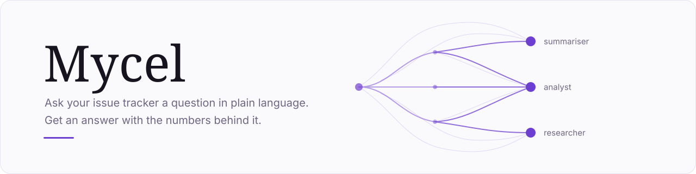

<div align="center">

<picture>
  <source media="(prefers-color-scheme: dark)" srcset="assets/banner-dark.svg">
  
</picture>

<p>
  <a href="https://github.com/vuzlee/mycel/actions/workflows/ci.yml"></a>
  <a href="https://www.python.org/"></a>
  <a href="https://www.typescriptlang.org/"></a>
  <a href="https://docs.astral.sh/ruff/"></a>
  <a href="https://mypy-lang.org/"></a>
  <a href="LICENSE"></a>
</p>

</div>

Ask your work a question in plain language. Mycel reads Jira, Gmail, Calendar and your
documents, answers with the sources it used, and books or updates things only after you say yes.

https://github.com/user-attachments/assets/3cedd419-ee7f-49ac-9e92-9efb14e237ca

<picture>
  <source media="(prefers-color-scheme: dark)" srcset="assets/flow-dark.svg">
  
</picture>

## Features

| | |
|---|---|
| **Ask in plain language** | Progress, what is late, who logged what, with charts when numbers help |
| **Knowledge** | Upload PDF, Word or Markdown; answers quote the passage and link the page |
| **Mail and calendar** | Triage your inbox, book a meeting after you confirm the draft |
| **Your model** | Host models through LiteLLM, or your own OpenAI-compatible keys |
| **Self-hosted** | One team, your database, your keys. Not built to face the internet |

## Quickstart

```bash
cp .env.example .env
scripts/stack.sh doctor   # what is missing, and what each absence costs
```

Then pick one of three ways to run it. The app is the same in each; the stores
(Postgres, RabbitMQ, Redis, Qdrant, MinIO, LiteLLM) always run in Docker Compose.

| Mode | App runs | Use it for |
|---|---|---|
| `dev` | on the host with `uv` | writing code, no rebuild per edit |
| `compose` | in containers, the CI image | checking the image |
| `k8s` | the Helm chart on minikube | checking the chart |

<details open>
<summary><b>dev</b> — Docker, uv, Node 22</summary>

```bash
curl -LsSf https://astral.sh/uv/install.sh | sh   # uv, which brings Python 3.11
cd web && npm ci && npm run build && cd ..        # the UI, served from web/dist
scripts/stack.sh dev up                           # stores, migrations, API, workers, scheduler
```
</details>

<details>
<summary><b>compose</b> — Docker only</summary>

```bash
scripts/stack.sh compose up               # add `monitoring` for Prometheus, Loki, Grafana
```
</details>

<details>
<summary><b>k8s</b> — Docker, minikube, kubectl, Helm</summary>

```bash
# Linux x86-64; other platforms: minikube.sigs.k8s.io/docs/start
curl -LO https://storage.googleapis.com/minikube/releases/latest/minikube-linux-amd64
sudo install minikube-linux-amd64 /usr/local/bin/minikube
curl -LO "https://dl.k8s.io/release/$(curl -Ls https://dl.k8s.io/release/stable.txt)/bin/linux/amd64/kubectl"
sudo install kubectl /usr/local/bin/kubectl
curl -fsSL https://raw.githubusercontent.com/helm/helm/main/scripts/get-helm-3 | bash

minikube start --driver=docker && minikube addons enable ingress
scripts/stack.sh k8s build                # both images, loaded into minikube
scripts/stack.sh k8s up                   # add `monitoring` as above
minikube tunnel                           # then add mycel.local to /etc/hosts
```

More in [deploy/](deploy/README.md). On AWS (EKS, planned): [docs/plan/aws-phase-1.html](docs/plan/aws-phase-1.html).
</details>

Open <http://localhost:8000/app> (or <http://mycel.local/app> on k8s) and sign in with
Google or an emailed code. First time: create the Jira and Google OAuth apps, fill `.env`,
edit the models in `config/litellm/models.yaml`, then `scripts/stack.sh doctor` — steps in
[docs/operate/setup.html](docs/operate/setup.html). Stop with `scripts/stack.sh <mode> down`.

## Development

```bash
uv run ruff check . && uv run mypy && uv run pytest   # backend
cd web && npm run lint && npm test && npm run build   # frontend
```

Answer quality is scored separately, see [evals](evals/README.md).
Handbook: [docs/index.html](docs/index.html) — one figure per flow, checked against the code (`docs/tools/check.py`).

## License

[MIT](LICENSE) © 2026 vuzle
